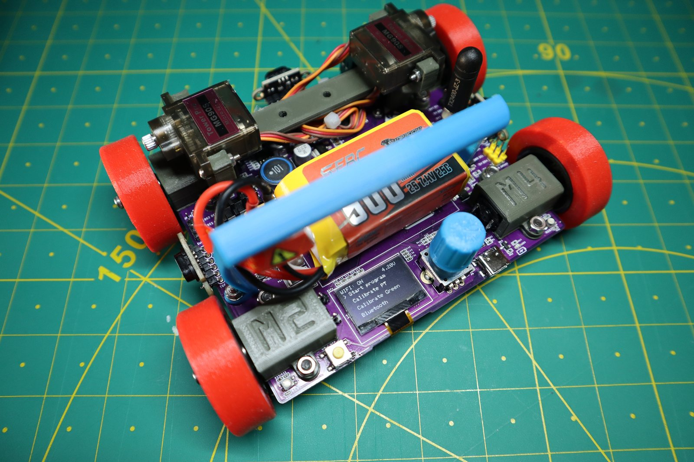
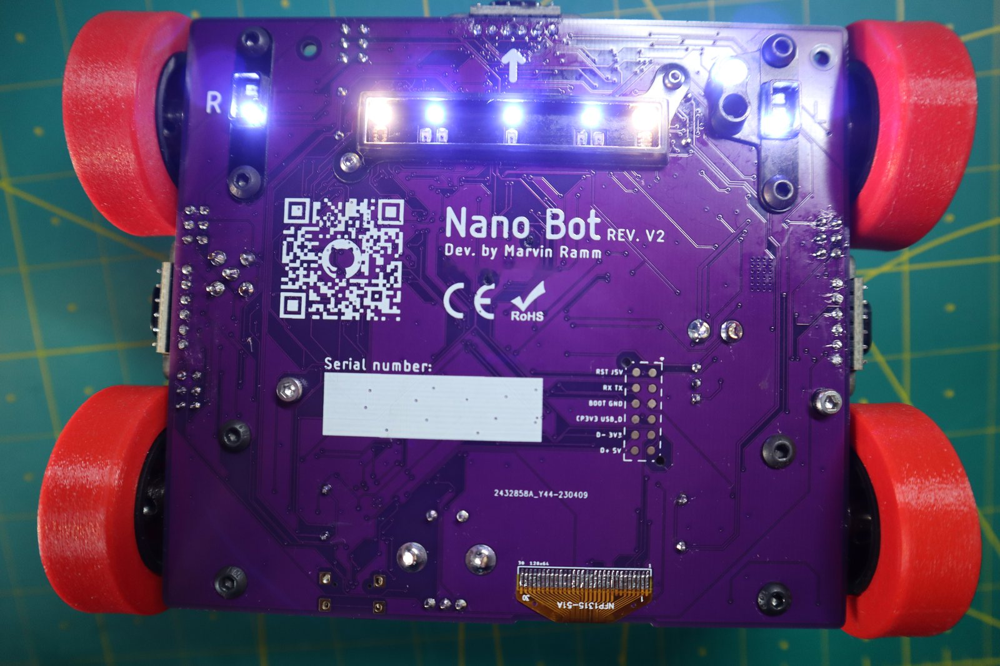
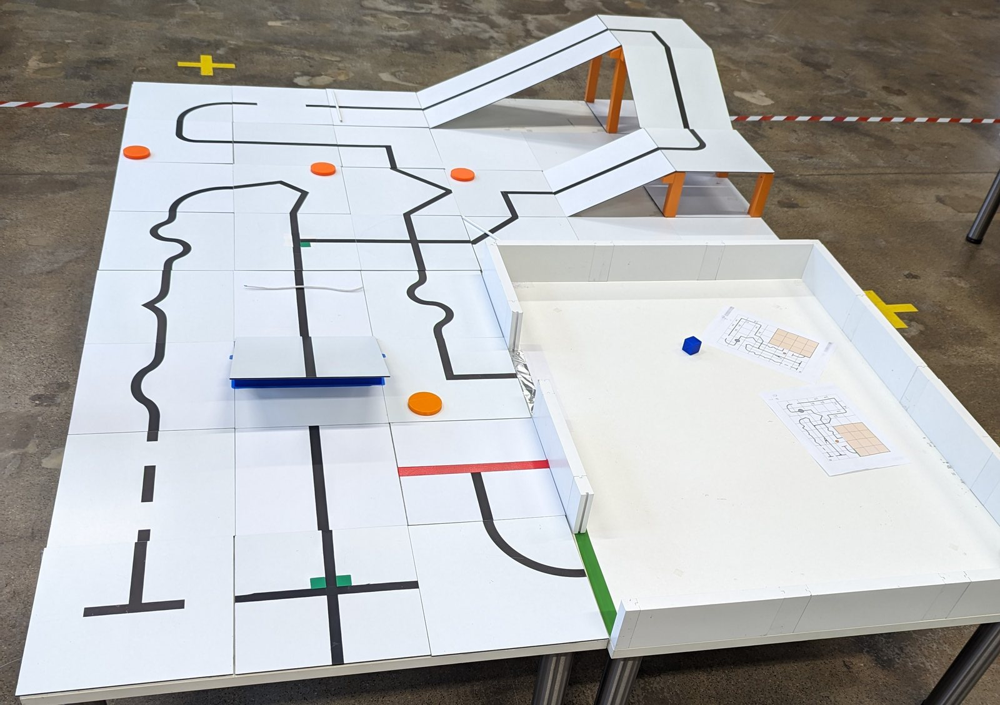
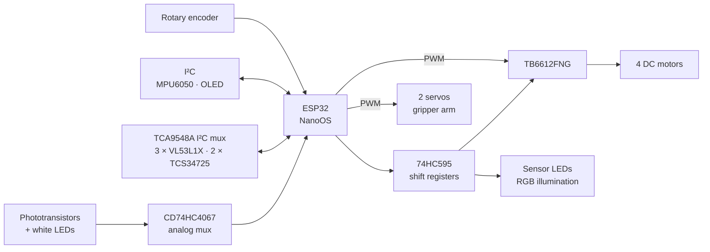
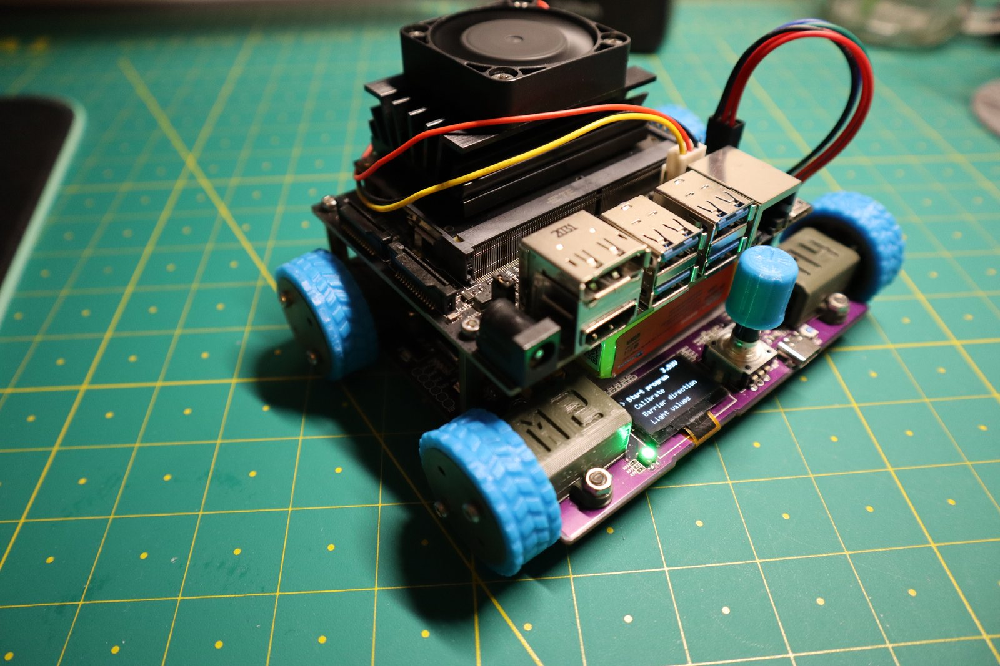
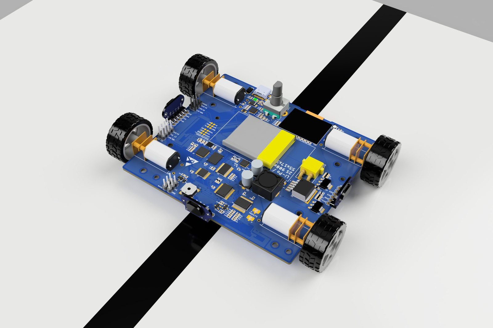

# NanoBot

[](LICENSE)
[](hardware/LICENSE)

**Line-following robot for RoboCup Junior Rescue Line, where the PCB is the chassis. It has an ESP32, eight light sensors, two colour sensors, three ToF distance sensors, a gyro, a gripper arm, and its own firmware, NanoOS.**

<p align="center">
  
  
</p>

I built the NanoBot in 2022–2023 as my RoboCup robot. The motors, wheels and sensors mount straight onto the PCB, so the robot needs no separate chassis and stays at 113 × 101 mm. I designed the electronics, the 3D-printed mechanics and the firmware myself, over two hardware revisions.

## The task



In Rescue Line, the robot follows a black line on its own through a course of tiles. Along the way it has to handle:

- gaps in the line
- intersections with green markers that set the direction
- speed bumps, ramps and obstacles

At the end, a silver strip marks the entrance to the evacuation zone.

## Features

- **PCB as chassis:** four DC motors in 3D-printed mounts, TPE tires that grip, and a TB6612FNG driver
- **Light sensor bar:**
  - phototransistors with white LEDs under a printed light shield
  - outer sensors on both sides
  - two TCS34725 colour sensors for the green markers
  - a reflection sensor for the silver strip
- **Three ToF distance sensors** (VL53L1X) for obstacles and walls
- **MPU6050 gyro** for ramps and exact turns
- **Two servo outputs**, e.g. for the gripper arm
- **0.96" OLED and rotary encoder** for:
  - a menu to start the run
  - calibration of light and colour values, stored in the EEPROM
  - sensor read-outs and a system check
- **Power:**
  - 2S Li-Po via XT30
  - USB-C charger with cell balancing
  - undervoltage protection and a battery switch
  - its own buck converter for constant motor speed
- **Over-the-air updates** over Wi-Fi, and a contest mode that starts the run right after power-on
- **Mount and 5 V / 4 A supply for an NVIDIA Jetson Nano** for image processing (REV1)

## How it works



The ESP32 reads the phototransistors through the analog multiplexer. The colour and ToF sensors share one I²C address, so each one sits on its own channel of the TCA9548A. Shift registers save GPIOs: they set the motor directions and switch the sensor LEDs.

NanoOS keeps the line between the outer sensors with a proportional correction. It decides on every tile what to do (turn, green marker, gap, dead end, obstacle) and uses the gyro angle to switch to its own speeds on ramps and speed bumps.

## Revisions

<p align="center">
  
  
</p>

| | REV1 (2022) | REV2 (2023) |
|---|---|---|
| **Status** | Stable, used with the Jetson Nano | Prototype with known issues (e.g. the reset button does not work) |
| **Light sensors** | 5 phototransistors, 2 × TCS34725 | 8 phototransistors incl. outer sensors and a reflection sensor, RGB illumination, 2 × TCS34725 |
| **Distance** | 3 × VL53L0X | 3 × VL53L1X |
| **Power** | LM2576 5 V / 4 A for the Jetson Nano, AMS1117 | adds USB-C charger, balancing, undervoltage protection, battery switch, motor buck converter |
| **Antenna** | 2 × U.FL | SMA |
| **Firmware** | [NanoOS 0.80](firmware/NanoOS-REV1) | [NanoOS 1.15](firmware/NanoOS) |

The lessons from both boards went into [**RoboCore**](https://github.com/marvinramm/RoboCore). RoboCore is a much smaller Raspberry Pi HAT that splits real-time control (ESP32-S3) and image processing (Pi).

## Repository layout

```
firmware/NanoOS/          NanoOS 1.15 for REV2 (Arduino sketch)
firmware/NanoOS-REV1/     NanoOS 0.80, the last version for REV1
hardware/nanobot-rev1/    Schematic, BOM, ESP32 pin assignment
hardware/nanobot-rev2/    Schematic, BOM, ESP32 pin assignment, EAGLE source
hardware/mechanical/      3D-printed parts: motor mounts, rims, tires, light shields, encoder knob
docs/images/              Pictures used in this README
```

Gerber files and ready-to-flash firmware images are attached to the [releases](https://github.com/marvinramm/NanoBot/releases). Libraries, Arduino settings and flashing are described in [`firmware/README.md`](firmware/README.md).

## License

© 2022–2023 Marvin Ramm. Open source with attribution:

- Code (`firmware/`): [MIT](LICENSE)
- Hardware and documentation: [CC BY 4.0](hardware/LICENSE)

Commercial use is allowed. Credit "NanoBot by Marvin Ramm" with a link to this repository. Details are in [LICENSING.md](LICENSING.md).
